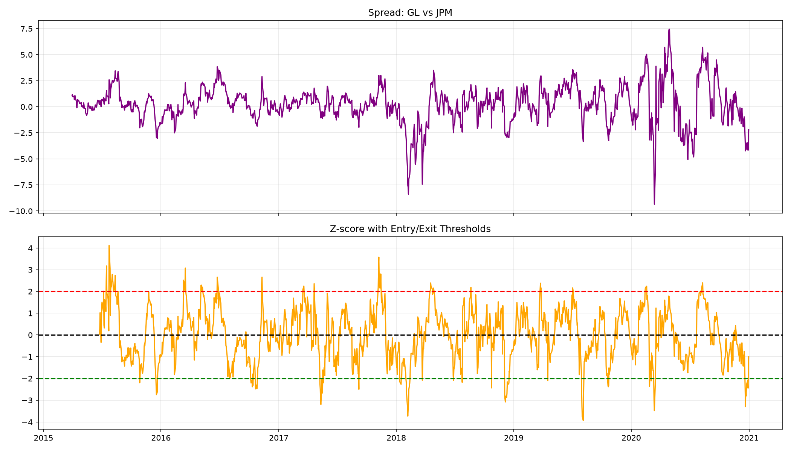
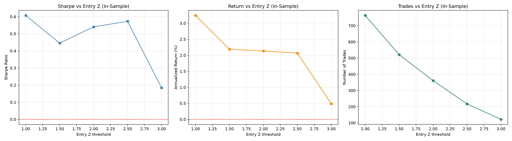
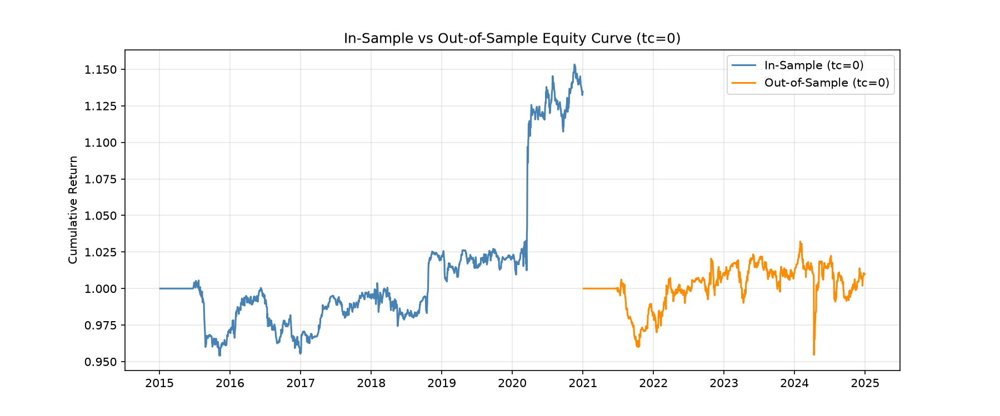

# Pairs Trading Strategy Using Cointegration on S&P 500 Stocks

**Author:** Jason Li
**Date:**  27/9/2026
**Project:** Statistical Arbitrage / Pairs Trading

---

## Abstract

This project implements and evaluates a simple pairs trading strategy based on the Engle-Granger cointegration framework, applied to the S&P 500 universe over the period 2015–2024. Candidate pairs are first filtered by return correlation (threshold 0.80) and then tested for cointegration using the Engle-Granger test (p-value < 0.05). For each selected pair, a rolling 60-day OLS regression is used to estimate the hedge ratio, and the resulting spread is normalized into a Z-score. Trading signals are generated when the Z-score exceeds ±2, with exit at Z = 0, a stop-loss at |Z| = 3.5, and a maximum holding period of 30 days. The strategy is backtested in-sample (2015–2020) and validated out-of-sample (2021–2024), with sensitivity analyses on transaction costs and entry thresholds.

The results show that the strategy earns a positive but thin alpha in-sample: with zero transaction costs, the annualized return is **2.13%** with a Sharpe ratio of **0.54**. However, performance is highly sensitive to trading costs. The break-even cost is approximately **10–12 bps (one-way)**; at 20 bps, the Sharpe ratio turns negative (−0.38). Out-of-sample, even with zero costs, the Sharpe ratio collapses to **0.055**, indicating that most of the in-sample performance is attributable to data-mining bias rather than a persistent mean-reversion opportunity. The strategy's win rate is below 50% in all configurations, implying that profits are concentrated in a small number of trades. We conclude that a simple cointegration-based pairs trading strategy on S&P 500 stocks is **not profitable under realistic market conditions**, and we discuss the broader implications for statistical arbitrage.

---

## 1. Introduction

Pairs trading is one of the oldest and most widely studied statistical arbitrage strategies. The core idea is straightforward: if two assets share a long-run equilibrium relationship (i.e., they are *cointegrated*), then temporary deviations of their relative price from this equilibrium should eventually revert. A trader can exploit this by going long the underpriced asset and short the overpriced one when the spread widens, and closing the position when the spread converges.

Despite its simplicity, pairs trading has attracted sustained academic and practitioner interest, not least because its profitability has declined substantially over the past two decades (Do & Faff, 2010; Krauss, 2017). The main reasons are well documented:

1. **Cointegration is not stable over time.** Pairs that pass cointegration tests in one sample often fail out-of-sample.
2. **Alpha is thin.** Profits are easily eroded by transaction costs, slippage, and market impact.
3. **Data-mining bias.** Selecting pairs from a large universe (e.g., S&P 500) generates many false positives, especially when the same data is used both to select pairs and to evaluate performance.

This project builds a complete, reproducible pairs trading pipeline on the S&P 500 universe and evaluates it under strict in-sample / out-of-sample separation, transaction cost sensitivity, and parameter sensitivity. Our goal is **not to "find a profitable strategy"** but to **quantify the realistic limits of a simple cointegration-based approach** and to document its failure modes honestly.

The remainder of this report is organized as follows. Section 2 describes the data and methodology. Section 3 presents the in-sample results and parameter sensitivity. Section 4 evaluates transaction cost sensitivity. Section 5 reports out-of-sample performance. Section 6 discusses the results and Section 7 concludes.

---

## 2. Data and Methodology

### 2.1 Data

- **Universe:** Current S&P 500 constituents, retrieved from Wikipedia and mapped to Yahoo Finance tickers.
- **Period:** January 2015 – December 2024.
- **Frequency:** Daily adjusted closing prices.
- **Source:** Yahoo Finance via the `yfinance` Python library.
- **Cleaning:** Stocks with missing data or short histories are removed. The final cleaned price matrix contains **458 stocks** and **2,515 trading days**.

The sample is split into:

- **In-sample:** 2015–2020 (used for pair selection and parameter tuning).
- **Out-of-sample:** 2021–2024 (used exclusively for validation).

### 2.2 Cointegration Testing

For each candidate pair of stocks (A, B), we apply the Engle-Granger two-step procedure:

1. Estimate the long-run relationship via OLS:  
   `log(Price_A) = α + β · log(Price_B) + ε`
2. Test the residuals ε for stationarity using the Augmented Dickey-Fuller (ADF) test.

Because testing all ~104,000 possible pairs is computationally expensive, we apply a **correlation pre-filter**: only pairs with |correlation| ≥ 0.80 (based on daily returns) are tested for cointegration. This reduces the number of tested pairs to a manageable size and is a standard practice in the literature.

### 2.3 Signal Construction

For each selected pair:

- **Rolling hedge ratio:** A 60-day rolling OLS regression is used to estimate β dynamically.
- **Spread:** `Spread_t = log(Price_A,t) − α_t − β_t · log(Price_B,t)`
- **Z-score:** `Z_t = (Spread_t − mean_60(Spread)) / std_60(Spread)`

### 2.4 Trading Rules

| Parameter | Value |
|---|---|
| Entry Z threshold | ±2.0 (tested: 1.0 – 3.0) |
| Exit Z threshold | 0.0 |
| Stop-loss | \|Z\| > 3.5 |
| Maximum holding period | 30 trading days |
| Transaction cost (one-way) | 0 – 50 bps (tested) |

Positions are equal-weighted across the top 10 pairs.

---

## 3. In-Sample Results and Parameter Sensitivity

### 3.1 In-Sample Performance (Zero Cost)

With transaction costs set to zero, the in-sample portfolio achieves:

| Metric | Value |
|---|---|
| Annualized Return | **+2.13%** |
| Annualized Volatility | 3.95% |
| Sharpe Ratio | **0.540** |
| Max Drawdown | −5.12% |
| Win Rate | 49.6% |
| Number of Trades | 361 |
| Turnover | 60.2 |

The Sharpe ratio of 0.54 indicates a **weak but positive alpha** in-sample. However, the win rate being below 50% shows that most trades lose money — profits are concentrated in a small number of large winners.

  
*Figure 1: Spread and Z-score for the example pair GL vs JPM. The Z-score oscillates around zero and repeatedly crosses the ±2 entry thresholds, triggering trades.*

### 3.2 Entry Threshold Sensitivity

We vary the entry Z threshold from 1.0 to 3.0 while holding other parameters fixed.

  
*Figure 2: Sharpe ratio, annualized return, and number of trades as a function of the entry Z threshold.*

| Entry Z | Sharpe | Annualized Return | Number of Trades |
|---|---|---|---|
| 1.0 | **0.61** | **+3.2%** | ~760 |
| 1.5 | 0.44 | +2.2% | ~520 |
| 2.0 | 0.54 | +2.1% | ~360 |
| 2.5 | **0.57** | +2.05% | ~210 |
| 3.0 | 0.19 | +0.5% | ~110 |

Two observations:

1. **Entry Z = 2.0–2.5 is the "sweet spot."** Sharpe peaks around 0.57 at Z = 2.5, with substantially fewer trades than at Z = 1.0.
2. **Lower thresholds generate more trades and higher gross returns, but also much higher turnover**, which makes the strategy more vulnerable to transaction costs (Section 4).
3. **Very high thresholds (Z = 3.0) starve the strategy of signals**, collapsing both Sharpe and return.

---

## 4. Transaction Cost Sensitivity

We sweep the one-way transaction cost from 0 to 50 bps.

![Transaction Cost Sensitivity]cost_sensitivity.png)  
*Figure 3: Sharpe ratio and annualized return as a function of one-way transaction cost.*

| Cost (bps) | Sharpe | Annualized Return |
|---|---|---|
| 0 | 0.540 | +2.13% |
| 2 | 0.447 | +1.76% |
| 5 | 0.307 | +1.21% |
| 10 | 0.075 | +0.30% |
| 20 | −0.384 | −1.51% |
| 50 | −1.692 | −6.73% |

**Key finding:** the strategy's break-even cost is roughly **10–12 bps one-way**. Beyond that point, the Sharpe ratio and annualized return both turn negative.

This is a critical result. Even under optimistic assumptions about execution quality, realistic all-in costs for a mid-cap US equity strategy typically exceed 10 bps. Under more conservative assumptions (20 bps), the strategy loses money decisively. The profit margin of the strategy is simply **too thin to survive real-world frictions**.

---

## 5. Out-of-Sample Validation

The strategy parameters selected in-sample (Entry Z = 2.0, Exit Z = 0.0, 30-day max holding) are applied unchanged to the out-of-sample period 2021–2024. Even with zero transaction costs:

| Metric | In-Sample (tc=0) | Out-of-Sample (tc=0) |
|---|---|---|
| Annualized Return | +2.13% | +0.24% |
| Sharpe Ratio | **0.540** | **0.055** |
| Max Drawdown | −5.1% | −7.5% |
| Win Rate | 49.6% | 45.4% |
| Number of Trades | 361 | 218 |

With a one-way cost of 10 bps, the out-of-sample Sharpe falls to **−0.31**, with annualized return of **−1.40%**.

  
*Figure 4: Cumulative return of the in-sample and out-of-sample portfolios (zero cost).*

The equity curves tell the story clearly: the in-sample portfolio rises steadily (with a sharp jump in early 2020), while the out-of-sample portfolio is essentially flat, oscillating around 1.00.

**Interpretation:** the in-sample Sharpe of 0.54 is largely a product of **data-mining bias**. The same data was used both to select pairs and to estimate performance, which inflates in-sample metrics. When applied to unseen data, the strategy has essentially **no alpha** — before even accounting for costs.

---

## 6. Discussion

Our results align with the broader literature on the decay of simple statistical arbitrage strategies (Do & Faff, 2010; Krauss, 2017). Three findings are particularly important.

### 6.1 Cointegration is fragile out-of-sample

Pairs that pass the Engle-Granger test in 2015–2020 frequently fail to remain cointegrated in 2021–2024. This is not a bug in our implementation — it is an inherent property of the method. Economic relationships between firms change: business models shift, capital structures evolve, index composition changes. A cointegration relationship estimated on one sample is, at best, a weak prior for the next.

### 6.2 Transaction costs dominate the P&L

The strategy's gross alpha is around 2% per year. At a turnover of 60× per year, even a 10 bps one-way cost consumes nearly all of it. This is not unique to our strategy — it is the central reason why high-frequency statistical arbitrage is dominated by firms with **institutional-grade execution infrastructure**. Retail-scale backtests that assume zero or near-zero costs are systematically misleading.

### 6.3 Win rate below 50% indicates high concentration

A win rate of 45–50% with positive gross returns implies that the average losing trade is smaller than the average winning trade. In practice, this means a small number of trades carry the strategy. If those trades are removed (or if execution is slightly worse than assumed), the strategy collapses. This fragility is a common characteristic of mean-reversion strategies and should be reported explicitly.

### 6.4 Implications for practitioners

Our results do not imply that pairs trading is universally unprofitable. They imply that:

- **Naive cointegration selection is not sufficient.** Modern implementations use more robust pair selection (e.g., distance, copula, machine-learning-based clustering) and richer features (e.g., fundamentals, sector, liquidity).
- **Cost modelling is not optional.** Any backtest without realistic transaction costs should be treated as an upper bound on performance, not a forecast.
- **Out-of-sample validation is essential.** Reporting only in-sample Sharpe ratios invites overfitting and misleads both researchers and investors.

---

## 7. Conclusion

We implemented a complete pairs trading pipeline on the S&P 500 universe (2015–2024), including correlation pre-filtering, Engle-Granger cointegration testing, rolling OLS hedge ratio estimation, Z-score signal generation, and a full backtest with transaction costs, stop-loss, and maximum holding period.

Our main findings are:

1. **In-sample, the strategy has a weak positive alpha** (Sharpe 0.54, annualized return 2.13% at zero cost).
2. **Alpha is extremely cost-sensitive.** The break-even cost is 10–12 bps one-way; at 20 bps, Sharpe turns negative.
3. **Out-of-sample, the strategy has essentially no alpha.** Even with zero cost, the Sharpe ratio is 0.055.
4. **The strategy's win rate is below 50%**, implying profit concentration in a few trades.

We therefore conclude that a **simple cointegration-based pairs trading strategy on S&P 500 stocks is not profitable under realistic market conditions**. The project's contribution is not a profitable trading signal, but a rigorous, honest, and reproducible evaluation of a classical statistical arbitrage approach — including its failure modes, its cost sensitivity, and its vulnerability to overfitting.

---

## References

- Do, B., & Faff, R. (2010). Does simple pairs trading still work? *Financial Analysts Journal*, 66(4), 83–95.
- Krauss, C. (2017). Statistical arbitrage pairs trading strategies: Review and outlook. *Journal of Economic Surveys*, 31(2), 513–545.
- Gatev, E., Goetzmann, W. N., & Rouwenhorst, K. G. (2006). Pairs trading: Performance of a relative-value arbitrage rule. *Review of Financial Studies*, 19(3), 797–827.
- Vidyamurthy, G. (2004). *Pairs Trading: Quantitative Methods and Analysis*. Wiley.

---

## Appendix: Code and Reproducibility

All code is available in `pairs_trading_code.py`. Reproducing the results requires:
pip install pandas numpy yfinance matplotlib seaborn statsmodels scipy scikit-learn requests lxml

Figures in this report are generated by the script and saved as:

- `spread_zscore.png`
- `entry_z_sensitivity.png`
- `cost_sensitivity.png`
- `is_vs_oos_equity.png`
