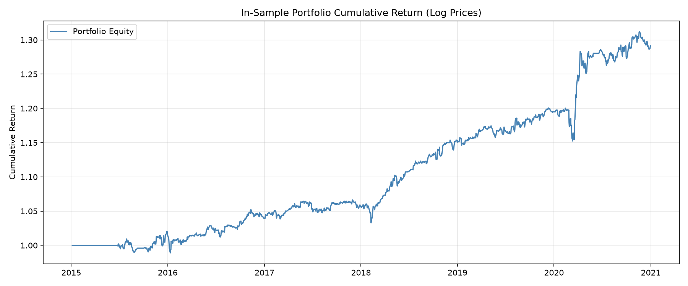
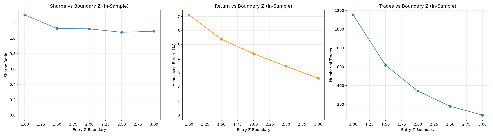
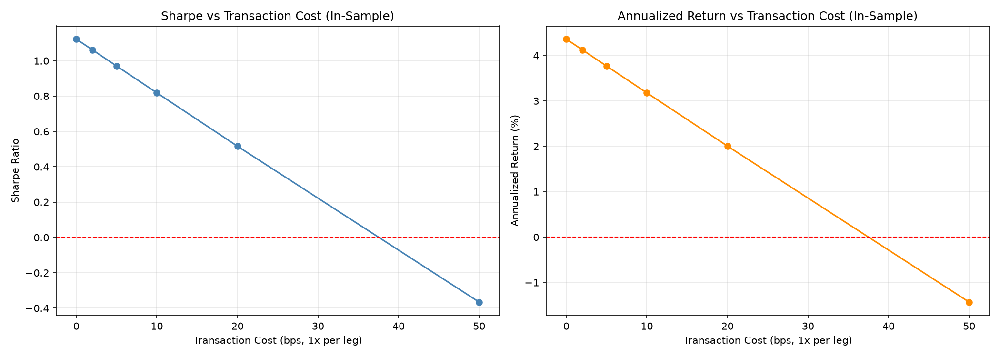
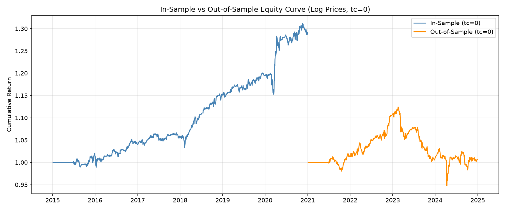

# Pairs Trading Strategy Using Cointegration on S&P 500 Stocks (Log-Price Formulation)

**Author:** Jason Li  
**Topic:** Statistical Arbitrage / Quantitative Finance  
**Universe:** S&P 500 Constituents (2015–2024)

---

## Overview

This project implements, backtests, and evaluates a statistical arbitrage pairs trading pipeline on S&P 500 equities over a 10-year window (**January 2015 – December 2024**). Building on the Engle-Granger cointegration framework, the strategy models spreads in **natural log-price space**, estimates dynamic hedge ratios via a **60-day rolling Ordinary Least Squares (OLS)** regression, and executes mean-reversion trades based on standardized Z-score boundaries with symmetric per-leg transaction costs ($1\times tc$ on entry and $1\times tc$ on exit).

Rather than curve-fitting for illusory backtest returns, the repository emphasizes **reproducible quantitative research hygiene**: strict in-sample vs. out-of-sample partitioning, coordinated boundary sensitivity sweeps, transaction cost break-even analysis, and honest documentation of out-of-sample structural decay.

---

## Methodology

### 1. Data Ingestion & Sample Split
* **Universe:** Current S&P 500 constituents scraped from Wikipedia and mapped to Yahoo Finance tickers (`yfinance`).
* **Data Cleaning:** Daily adjusted closing prices (`2015-01-01` to `2024-12-31`), dropping series with missing observations and transforming all prices into natural logarithms: $p_t = \ln(P_t)$.
* **Strict Sample Partition:**
  * **In-Sample (`2015-01-01` to `2020-12-31`):** Exclusively used for correlation pre-filtering, Engle-Granger cointegration screening, and parameter sensitivity analysis.
  * **Out-of-Sample (`2021-01-01` to `2024-12-31`):** Reserved strictly for blind validation using the top 10 pairs and baseline parameters fixed in-sample.

### 2. Log-Price Cointegration Screening
To avoid testing all $\binom{N}{2}$ combinations indiscriminately, candidate pairs are pre-filtered using daily log-return correlation ($|\rho| \ge 0.80$). Surviving pairs undergo the two-step **Engle-Granger test**:
1. Estimate the long-run equilibrium via OLS:
   $$\ln(P_{A,t}) = \alpha + \beta \ln(P_{B,t}) + \varepsilon_t$$
2. Test the residuals $\varepsilon_t$ for stationarity via the Augmented Dickey-Fuller (ADF) unit root test using MacKinnon critical values ($p < 0.05$).
3. Rank qualifying pairs by $p$-value and construct an equal-weighted portfolio across the **top 10 pairs**.

### 3. Rolling Signal Construction & Execution Rules
For each pair, a 60-day rolling OLS window dynamically updates $\alpha_t$ and the hedge ratio $\beta_t$:
$$\text{Spread}_t = \ln(P_{A,t}) - (\alpha_t + \beta_t \ln(P_{B,t})), \qquad Z_t = \frac{\text{Spread}_t - \mu_{60}}{\sigma_{60}}$$

| Parameter | Baseline Value | Evaluated Sensitivity Range |
| :--- | :--- | :--- |
| **OLS & Z-Score Lookback** | 60 trading days | Fixed |
| **Entry Z Boundary** | $\pm 2.0$ | $1.0, 1.5, 2.0, 2.5, 3.0$ |
| **Exit Z Boundary** | $0.0$ | $0.00, 0.00, 0.00, 0.25, 0.50$ (scaled with Entry Z) |
| **Stop-Loss Z Boundary** | $\pm 3.5$ | $2.5, 3.0, 3.5, 4.0, 4.5$ (scaled with Entry Z) |
| **Max Holding Period** | 30 trading days | Fixed |
| **Transaction Cost ($tc$)** | 0 bps (baseline) | $0, 2, 5, 10, 20, 50$ bps ($1\times tc$ entry & $1\times tc$ exit) |

---

## Key Empirical Findings

### 1. In-Sample Performance (`2015–2020`, Zero Cost)
Formulating cointegration and spreads in log-price space substantially improves in-sample signal quality compared to raw price levels (where in-sample Sharpe was $0.54$ and annualized return was $+2.13\%$):
* **Cumulative Ending Equity:** ~`1.291` (`+29.1%`)
* **Annualized Return:** `+4.35%`
* **Annualized Sharpe Ratio:** `1.12`



### 2. Coordinated Boundary Z-Score Sensitivity
Scaling exit and stop-loss thresholds alongside the entry boundary keeps the in-sample Sharpe ratio resilient above `1.07` across all tested regimes:

| Entry Z | Exit Z | Stop-Loss Z | Sharpe Ratio | Annualized Return | Approx. Trades |
| :---: | :---: | :---: | :---: | :---: | :---: |
| 1.0 | 0.00 | 2.5 | 1.30 | +7.10% | ~1,150 |
| 1.5 | 0.00 | 3.0 | 1.13 | +5.38% | ~615 |
| **2.0** | **0.00** | **3.5** | **1.12** | **+4.35%** | **~340** |
| 2.5 | 0.25 | 4.0 | 1.08 | +3.47% | ~180 |
| 3.0 | 0.50 | 4.5 | 1.09 | +2.62% | ~85 |



### 3. Transaction Cost Sensitivity ($1\times tc$ per leg)
With stronger gross alpha in log-price space and symmetric per-leg costs, the strategy's in-sample break-even cost increases roughly threefold to **~36–37 bps per leg** (maintaining a Sharpe of `0.82` at 10 bps and `0.51` at 20 bps).



### 4. Out-of-Sample Validation (`2021–2024`, Zero Cost)
When the top 10 pairs selected on 2015–2020 data are traded out-of-sample without re-estimation, cumulative equity rises to ~`1.124` (`+12.4%`) in early 2023 before structural breaks during the 2023–2024 regime erase those gains, ending near `1.007` (`+0.65%` total return, ~`+0.16%` annualized) with a peak-to-trough drawdown of ~`-15.7%`.



---

## Repository Structure

```text
pairs-trading-strategy-by-Jason/
├── pairs_trading_code_2.py                  # Main data ingestion, cointegration, backtest & sensitivity script
├── pairs_trading_report_log_prices.html     # Full formatted research report
├── README.md                                # Project documentation & results summary
└── output_figures/                          # Auto-generated high-resolution figures
    ├── in_sample_equity.png
    ├── out_of_sample_equity.png
    ├── is_vs_oos_equity.png
    ├── cost_sensitivity.png
    ├── boundary_z_sensitivity.png
    └── spread_zscore_example.png
```

---

## Quickstart & Reproducibility

### Prerequisites
Install the required Python packages:
```bash
pip install numpy pandas yfinance matplotlib seaborn statsmodels scipy requests lxml
```

### Run the Pipeline
Execute the main script to download historical prices, run cointegration screening, backtest both in-sample and out-of-sample portfolios, and save all six figures into `output_figures/`:
```bash
python pairs_trading_code_2.py
```

---

## Limitations & Future Improvements

* **Walk-Forward Re-Estimation:** Static pair selection over a 6-year window suffers from cointegration decay out-of-sample. Replacing static selection with periodic walk-forward re-screening and Kalman filter hedge ratios would mitigate regime drift.
* **Survivorship Bias:** Using current S&P 500 constituents introduces survivorship bias; production implementations require point-in-time historical index constituents.
* **Vectorized / JIT Execution:** Compiling the inner state-machine execution loop with `Numba` (`@jit`) would dramatically accelerate scaling across larger universes and intraday bars.

---

## References
* Do, B., & Faff, R. (2010). Does simple pairs trading still work? *Financial Analysts Journal*, 66(4), 83–95.
* Gatev, E., Goetzmann, W. N., & Rouwenhorst, K. G. (2006). Pairs trading: Performance of a relative-value arbitrage rule. *Review of Financial Studies*, 19(3), 797–827.
* Krauss, C. (2017). Statistical arbitrage pairs trading strategies: Review and outlook. *Journal of Economic Surveys*, 31(2), 513–545.
* Vidyamurthy, G. (2004). *Pairs Trading: Quantitative Methods and Analysis*. John Wiley & Sons.